<div align="center">

<picture>
  <source media="(prefers-color-scheme: dark)" srcset="./assets/banner-dark.svg">
  <source media="(prefers-color-scheme: light)" srcset="./assets/banner.svg">
  
</picture>

<br/>


<br/>
<br/>

[](https://stevenzeiler.com)
[](https://twitter.com/modernfintech)
[](https://github.com/hugeai-inc)

</div>

---

## `> whoami`

```typescript
const steven = {
  role: "Builder",
  focus: ["AI agent infrastructure", "Vision ML", "Payment systems"],
  current: {
    hugeAI: "AI agent infrastructure",
    materialSamplesArt: {
      ios: "Vision ML sample scanner",
      macos: "SwiftUI board application",
      status: "in development"
    }
  },
  history: ["Built gatewayd at Ripple", "Anypay crypto payments"],
  principles: "Hyper-efficient money"
};
```

---

## `> ls ./projects`

```bash
drwxr-xr-x  huge-ai/              # AI agent infrastructure
drwxr-xr-x  material-samples-art/ # iOS vision ML + macOS SwiftUI (in dev)
drwxr-xr-x  ripple-gatewayd/      # Gateway infrastructure (2014)
drwxr-xr-x  anypay/                # Crypto payment systems
```

**[Huge AI](https://github.com/hugeai-inc)** — Building AI agent infrastructure  
**Material Samples Art** — Vision ML sample scanner (iOS) + SwiftUI board app (macOS), in development  
**Ripple** — Built gatewayd enabling crypto gateway infrastructure  
**Anypay** — Crypto payment acceptance solutions

---

## `> cat tech.stack`

<div align="center">


</div>

---

## `> git log --graph --oneline`

<div align="center">

<picture>
  <source media="(prefers-color-scheme: dark)" srcset="https://raw.githubusercontent.com/stevenzeiler/stevenzeiler/output/github-contribution-grid-snake-dark.svg">
  <source media="(prefers-color-scheme: light)" srcset="https://raw.githubusercontent.com/stevenzeiler/stevenzeiler/output/github-contribution-grid-snake.svg">
  
</picture>

<br/><br/>


</div>

---

## `> cat featured.repos`

<div align="center">

[](https://github.com/stevenzeiler/connecting-crypto-currencies)
[](https://github.com/stevenzeiler/blockchain-gatewayd-plugin)

</div>

---

## `> echo $CONTACT`

<div align="center">

```bash
# Building something in AI, vision ML, or payments? 
$ curl https://stevenzeiler.com
$ open https://twitter.com/modernfintech
$ git clone https://github.com/hugeai-inc
```

[](https://stevenzeiler.com)
[](https://twitter.com/modernfintech)
[](https://github.com/stevenzeiler)
[](https://github.com/hugeai-inc)

</div>

---

<div align="center">

```bash
$ uptime
Building AI agents | Shipping vision ML | Payments since 2014
```

</div>
